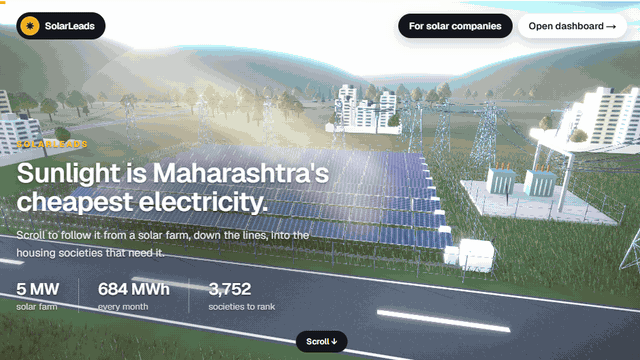

# Skills /oss

**Agent skills that teach Claude Code, Cursor and Codex to build scroll-driven sites, 3D websites and hackathon demo videos.**

[](https://github.com/Heet-P/skills/actions/workflows/ci.yml)
[](LICENSE)



```bash
npx skills add Heet-P/skills --skill scrollfx web3d demovideo
```

**Live demo:** [skills.heetp.tech](https://skills.heetp.tech). Scroll the two 3D sites yourself: [SolarLeads](https://skills.heetp.tech/demos/solarleads/) · [YieldGuard](https://skills.heetp.tech/demos/yieldguard/)

---

Every scroll site, 3D landing page and hackathon video above was built by prompting an agent. These skills are what I learned doing it: the patterns that worked and the bugs I hit, so the agent gets them right the first time.

No SDK, no API keys, no build step. A skill is a Markdown file. After installing, type a command (`/scrollfx smooth`) or just describe what you want; the agent loads the skill when the task matches. With no command, each skill asks what you're after and suggests what fits.

Works with Claude Code, Codex, Cursor, Cline, Roo and OpenHands. Want only one? `npx skills add Heet-P/skills --skill web3d`.

---

## My skills

### ScrollFX: scroll-driven sites (`skills/scrollfx/`)

GSAP ScrollTrigger + Lenis for React/Next.js. Every effect is cleaned up on unmount, split for mobile, and respects reduced motion.

| Command | What it does |
|---|---|
| `/scrollfx smooth` | Smooth scroll for the whole site: one Lenis instance synced to ScrollTrigger |
| `/scrollfx reveal` | Text fills in word by word as you scroll |
| `/scrollfx marquee` | Image rows that slide sideways as you scroll |
| `/scrollfx grow` | A hero image that scales up and lands on a target spot |
| `/scrollfx flip` | Tiles that do a 3D flip on hover |
| `/scrollfx dome` | Images on a draggable 3D sphere with inertia (CSS only) |
| `/scrollfx audit` | Checks existing scroll code against the checklist and fixes it |

*Learned from:* a hackathon event site with word reveals, opposite-direction photo marquees, a dark-mode flip mid-scroll, a pixel-font loader and a 3D photo dome.

### Web3D: 3D websites (`skills/web3d/`)

three.js / React Three Fiber scenes built entirely from code (no model files).

| Command | What it does |
|---|---|
| `/web3d scene` | A fast, client-only 3D scene with proper cleanup |
| `/web3d camera` | Camera flies between keyframes as the page scrolls |
| `/web3d glow` | Bloom + ambient occlusion that only hits what you choose |
| `/web3d labels` | HTML labels pinned to 3D points |
| `/web3d pick` | Click and hover 3D objects, results sent to React |
| `/web3d perf` | Adaptive quality, pause when hidden, instancing, disposal |
| `/web3d audit` | Checks an existing 3D page against the checklist and fixes it |

*Learned from:* **SolarLeads** ([source](https://github.com/Heet-P/SGP-II)), a scroll-driven R3F solar farm, and **YieldGuard** ([source](https://github.com/Parva-28/bob-ai-hackathon-DuckDuckGo)), a three.js semiconductor-fab scene with clickable wafers.

Both landing pages run live on the site: [`demos/solarleads/`](https://skills.heetp.tech/demos/solarleads/) and [`demos/yieldguard/`](https://skills.heetp.tech/demos/yieldguard/).

### DemoVideo: hackathon videos in code (`skills/demovideo/`)

Remotion launch films and app walkthroughs, all from prompts.

| Command | What it does |
|---|---|
| `/demovideo launch` | A 45–65s launch film: kinetic type, real UI, cuts on the beat |
| `/demovideo walkthrough` | Record the real app with Playwright, timed to narration, with captions and zooms |
| `/demovideo hook` | A 10-second slam-cut opener |
| `/demovideo music` | A soundtrack and sound effects generated in code, synced to the cuts |
| `/demovideo render` | 1080p + 4K, loudness normalised to -14 LUFS |

*Made with it:*
- RelayCare launch film and walkthrough ([`videos/`](videos/))
- YieldGuard for the IBM Bob hackathon ([`videos/yieldguard.mp4`](videos/yieldguard.mp4)), a team project with Dhrumil Amin, Parva Chhatrola and Akshat Patel
- SAHARA for the [Meta AI Hackathon](https://youtu.be/foh6WNTnbp0) and [Smart India Hackathon](https://www.youtube.com/watch?v=sk_WdN6rbXo)

---

## Skills I use but didn't write

These shaped how I work. All credit goes to their authors. Install from the original source.

| Author | Skills | Install |
|---|---|---|
| [Emil Kowalski](https://emilkowal.ski/) | emil-design-eng, animate, animation-performance, animation-vocabulary, apple-design, ask-sonner, break-ui, find-animation-opportunities, improve-animations, mobile-native, prototype, review-animations | `npx skills add emilkowalski/skills` |
| [pbakaus](https://github.com/pbakaus/impeccable) | impeccable: a design system with 20+ commands | `npx skills add pbakaus/impeccable` |
| [Leonxlnx](https://github.com/Leonxlnx/taste-skill) | design-taste-frontend: anti-slop frontend | `npx skills add Leonxlnx/taste-skill` |

Reference copies of `design-taste-frontend`, `emil-design-eng` and `impeccable` are kept in `skills/`. Install them from their original repos above, which is where updates land.

---

## Repository structure

```
skills/
├── scrollfx/SKILL.md          ← mine: scroll-driven sites
├── web3d/SKILL.md             ← mine: 3D websites
├── demovideo/SKILL.md         ← mine: hackathon videos in Remotion
├── design-taste-frontend/     ← credited (Leonxlnx)
├── emil-design-eng/           ← credited (Emil Kowalski)
└── impeccable/                ← credited (pbakaus)
videos/                        ← showcase videos + posters
demos/                         ← static exports of the two 3D landing pages
index.html, css/, js/          ← the website (static, no build)
```

---

## License

My skills and the website are [MIT](LICENSE). The credited skills belong to their authors under their own licences: `emil-design-eng` and `design-taste-frontend` are MIT, `impeccable` is Apache 2.0.

## Contributing

New recipes, fixes from your own builds and showcase links are welcome. See [CONTRIBUTING.md](CONTRIBUTING.md).

*Shared openly, with no strings and no guarantees. 2026.*
